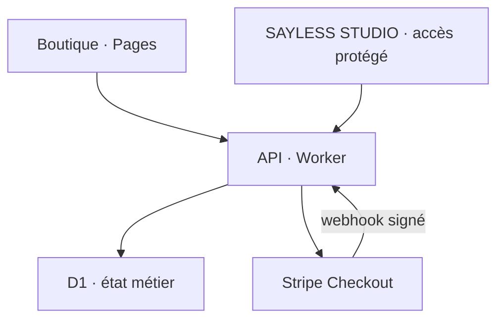

# Architecture et migration

## Préparation sur contrat v1.2

Le site statique appelle les routes de même origine gérées par `functions/api/[[path]].js`. Le catalogue public relit prix et publication en D1. La boutique utilise les SKU du produit, conserve seulement un stock vérifié récent et attend un devis signé avant de présenter le total. CGV et Turnstile précèdent la réservation et la création de session. Sur le retour Stripe, `POST /api/checkout/status` détermine l’état affiché. Le Worker `ops/` reçoit les webhooks et rapproche les paiements avec le même code métier et la même base que l’API publique.

Les choix de migration ci-dessous décrivent la situation initiale du 24 novembre. Les décisions actuelles figurent dans le [contrat v1.2](API-CONTRACT.md) et la [revue d’intégration](REVUE-PR-1-WORK.md).

## Cible validée par le fondateur

GitHub conserve le code ; Cloudflare Pages sert la boutique ; Workers gère les API ; D1 conserve l’état métier. Stripe Checkout reçoit les paiements. Claude développe SAYLESS STUDIO, les commandes, les expéditions Boxtal (ou équivalent), les notifications Discord et les e-mails Resend. Work intègre ces API dans la boutique et partage sa direction artistique.

Les expéditions, e-mails et alertes sont des sorties du serveur, jamais du navigateur. Aucun service payant ni compte n’est configuré par ce dépôt. Les offres gratuites doivent être vérifiées sur les comptes retenus, avec leurs plafonds et leur comportement en cas de dépassement ; aucune absence de frais ne peut être garantie par ce code.

## Code effectivement livré

L’aperçu v4 fournit une boutique en HTML/CSS/JS, servie par une route Vinext, ainsi qu’un prototype de stock D1 et Stripe test. Le dépôt conserve ce code et ses migrations, sans base ni secrets. La commande portable ne lance que les fichiers publics et refuse les API. Elle ne constitue pas un backend commercial.

Le build statique copie l’interface existante ; il n’est pas nécessaire de réécrire son design en React pour utiliser Pages. Les routes en hash `/#/...` fonctionnent dans un serveur statique. Les routes propres et leur référencement demandent une migration prévue, non effectuée dans cet export.

## Incompatibilités et décisions à coordonner

| Sujet | État hérité | Adaptation nécessaire |
| --- | --- | --- |
| Runtime | Vinext + Worker + greffons de prévisualisation | Servir le build statique sur Pages ; Claude crée son Worker et ses bindings |
| Identité admin | En-têtes `oai-authenticated-user-*` injectés par l’ancien hébergeur | Remplacer par une identité vérifiée côté serveur : passkeys proposées dans le dernier rapport, Access facultatif (JWT vérifié). Choix à confirmer ; aucun en-tête client ne fait autorité |
| Source de stock | `/api/inventory`, UUID de variantes, déclaration 26 non allouée | Nouveau `/api/stock`, SKUs stables, inventaire physique validé ; aucun fallback vers la déclaration |
| Modèle métier | Prototype limité à Rose/S/M/L et 26 au premier chargement | Claude généralise produits/drops/couleurs et migrations ; ne pas appliquer les anciennes contraintes au futur catalogue |
| Checkout | Simulation UI et opérations Stripe test réservées à l’admin | Sessions serveur, devis, coordonnées, relais valide, quantité et consentement ; un seul parcours client |
| API proposée dans le rapport | Carte simple SKU → quantité et deux erreurs 409 | Ajouter vérification, date, états de réservation et épuisement confirmé ; détails dans API-CONTRACT.md |
| Livraison Stripe | Le rapport propose deux tarifs dans la session | Le client a déjà choisi le mode et le relais : fixer côté serveur le choix validé pour éviter un changement incohérent dans Stripe |
| Données clients | Aucun envoi dans l’aperçu | Le rapport prévoit coordonnées chez Stripe ; il faut préciser le traitement temporaire avant paiement, les demandes et retours avant/après achat, la conservation et les droits |
| Suivi | Aucune page fonctionnelle | Éviter e-mail + numéro en query string ; POST de recherche puis accès borné et non énumérable |
| Webhooks | Bloqués par l’accès privé de l’ancien aperçu | Endpoint public authentifié par signature Stripe ; administration séparée protégée |
| Multi-produits | Présentation actuelle dédiée au Pink 001 | Le schéma catalogue et les APIs acceptent plusieurs produits ; rendre galerie/panier/fiches pilotés par ce catalogue est un travail frontend restant |
| SEO | Routes hash, `noindex` volontaire dans l’aperçu | URL propres, canonicals, Open Graph, sitemap et Product/Offer basés sur données vérifiées avant publication |

Ne pas déployer le prototype historique sous prétexte que ses tests locaux passent. Son authentification dépend de l’hébergeur d’origine et son schéma n’est pas celui de la cible. Aucun second serveur n’est développé dans ce dépôt.

## Provenance et conservation

Source v4 : commit `e271bd63ee1ca9d806a921511fbc12900de4c14f`. Tous ses fichiers suivis ont été copiés ; `docs/source-snapshot.json` conserve leurs SHA-256. Les adaptations de cette branche sont documentées dans CHANGELOG.md. Les fichiers backend et les migrations restent identiques à cette source.

L’identifiant de projet a été retiré de `.openai/hosting.json` dans la copie GitHub ; ce n’est pas une modification de l’aperçu publié. Aucun historique Git de l’atelier, configuration locale, dépendance installée, journal, base ou secret n’est transféré. Le `CNAME` de main n’est pas copié dans v2, et reste intact sur main.
